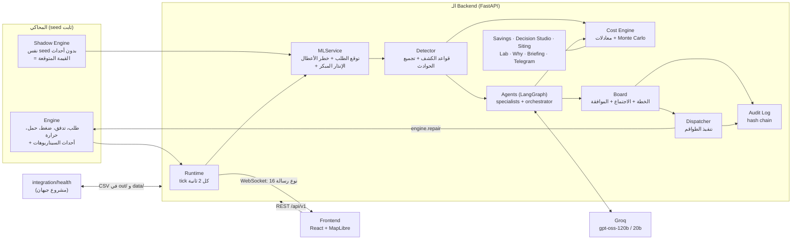
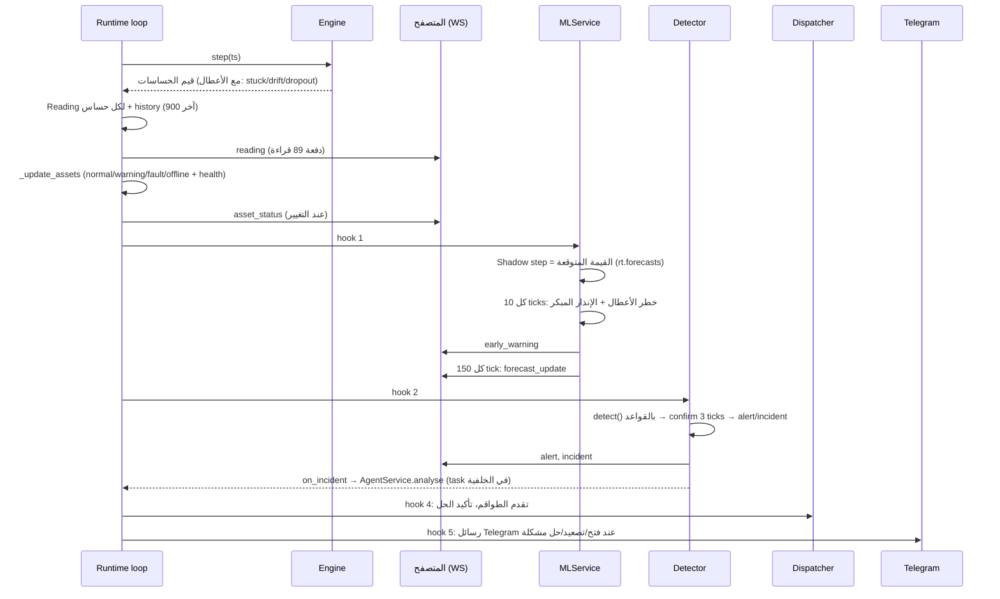
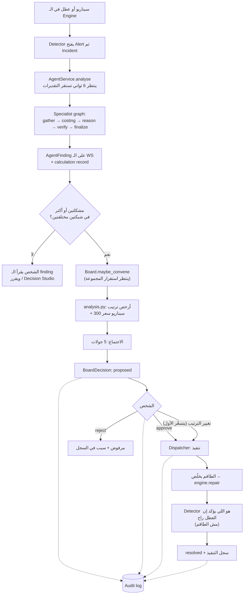
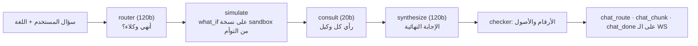
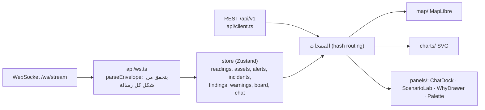
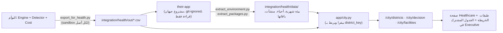

# معمارية Care Grid: الـ Architecture والـ Pipeline والـ Workflow

مكتوب بتاريخ 4 نوفمبر 2026 على الكود الحالي (فرع `dev`). كل خطوة هنا مأخوذة من الكود نفسه، وجنب كل واحدة الملف اللي بينفّذها. الرسومات بصيغة Mermaid (بتتعرض تلقائيًا على GitHub وفي VS Code بإضافة Markdown Preview Mermaid).

> **القاعدة اللي المعمارية كلها مبنية عليها:** كل رقم بيطلع من الكود (معادلة باسمها وافتراضات باسمها). الـ LLM بيشرح بس، وأي رقم في كلامه مش موجود في سجل الحسابات بيتشال قبل ما يوصل الشاشة.

---

## 1. الصورة الكبيرة



| الطبقة | المكان | بتعمل إيه |
|---|---|---|
| المحاكي | `backend/app/sim/` (`engine.py`, `topology.py`) | 9 أحياء، 48 أصل، 89 حساس، 3 شبكات. طلب بمنحنى يومي، تدفق وضغط وحمل وحرارة بعلاقات سببية. نفس الـ seed يطلّع نفس التشغيلة. |
| Runtime | `app/runtime.py` | يملك الـ Engine، يعمل tick كل 2 ثانية، يبث على WebSocket، ويستدعي الـ hooks. |
| ML | `app/ml/` | LightGBM لتوقع الطلب، موديل خطر الأعطال، الإنذار المبكر. |
| الكشف | `app/detection/` | قواعد كشف + تجميع: سبب جذري واحد = حادثة واحدة. |
| التكلفة | `app/cost/` | `IncidentFacts` ← تكلفة بالجنيه + P10/P50/P90 + سجل حساب. |
| الـ Agents | `app/agents/` | specialists (مياه/كهرباء/تبريد) + orchestrator + `checker.py` (فاحص الأرقام) + `llm.py` (غلاف Groq). |
| المجلس | `app/board/` | `plan.py` (البحث عن أرخص ترتيب)، `analysis.py` (الحسابات)، `session.py` (الاجتماع)، `dispatch.py` (الموافقة والتنفيذ)، `audit.py` (السجل). |
| باقي الأدوات | `savings.py`, `decision.py`, `siting.py`, `lab/`, `why.py`, `briefing.py`, `alerts.py`, `extras.py`, `city.py` | شرحها في القسم 6. |
| الواجهة | `frontend/src/` | React 18 + TypeScript + Vite + Zustand + MapLibre. |

---

## 2. التشغيل: إيه اللي بيتبني لما السيرفر يقوم

الملف `app/main.py`، بالترتيب:

1. `runtime = Runtime()` ← بيبني الـ Engine بالـ seed (42 افتراضيًا من `SIM_SEED`).
2. `AgentService(runtime)` ← بيبني الـ `Detector` (وبيدرّب Isolation Forest داخله)، وgraph الـ specialists، وgraph الـ orchestrator، والـ `Board` (ومعاه `Dispatcher` و`AuditLog`). بيسجّل hooks على الـ runtime.
3. `MLService(runtime, detector)` ← `ml.load_or_train` بيحمّل `data/models.pkl` أو بيدرّب من الأول لو مش موجود أو قديم؛ بيقيس الكشف مرة واحدة (`ml/evaluate.py`)؛ بيبني الـ Shadow Engine؛ بيبني `EarlyWarnings`. بيدخل أول hook.
4. `TelegramAlerts`, `BriefingService`, `History` (محرك baseline بدون أحداث)، `LabCache`, `Why`, `CityData`.
5. `lifespan`: `runtime.start()` (بيشغّل الـ loop)، وتسخين الـ AI lab في thread منفصل، وحلقة الـ briefing اليومية.
6. الـ backend بيخدم الواجهة المبنية كملفات static، فبورت واحد (8000) يكفي.

**ترتيب الـ tick hooks** (ده الترتيب الفعلي اللي بيتنفذ كل tick): `MLService.tick` ← `Detector.tick` ← `_sync_llm_mode` ← `Dispatcher.tick` ← `TelegramAlerts.tick`.

---

## 3. الـ Pipeline الرئيسي: كل tick (كل 2 ثانية)



تفاصيل كل خطوة:

| الخطوة | الكود | التفصيل |
|---|---|---|
| توليد القراءات | `Engine.step` | يرجّع الحقيقة الفيزيائية والقراءة (القراءة بتختلف عن الحقيقة لو الحساس stuck/drift/dropout). |
| حالة الأصل | `Runtime._update_assets` | الانحراف = بُعد القراءة عن المدى الطبيعي ÷ عرض المدى. أكتر من 0.5 = fault، أكتر من 0.05 = warning، الأصل المفصول = offline. health = حالة أساسية − 50 × الانحراف. |
| القيمة المتوقعة | `MLService.tick` | محرك ظل بنفس الـ seed ونفس الساعة ومن غير أي حدث. الفرق بين القراءة الفعلية وقيمته هو "الانحراف عن التوأم". |
| خطر الأعطال | `MLService._failure` (كل 10 ticks) | 6 مدخلات لكل مضخة/محول/ماسورة/محطة ← درجة خطر ← `EarlyWarnings.update`. |
| الإنذار المبكر | `ml/earlywarn.py` | الدرجة تتحسب مرتين (بقيم الأصل وبقيمة وسيط نظرائه). الفرق بمقياس log-odds ≥ 1.0 لمدة 3 قراءات والأصل لسه شغّال = إنذار. بعدها: أسباب (drivers)، تسعير الصيانة، وأرقام القياس (evidence). |
| الكشف | `Detector.detect` | قواعد بعتبات (فصل محطة، كسر ماسورة، تسريب خفي، عطل مضخة، عطل تبريد، حمل زائد، حساس عاطل). |
| التأكيد والتجميع | `Detector.tick` | الحالة لازم تستمر 3 ticks. التنبيه الجديد بيتربط بحادثة موجودة لو جذره داخل نطاق تأثيرها (blast radius) أو ليه نفس السبب الخارجي (مثلا حرارة). بيتقفل بعد 6 ticks من غير الحالة. |

---

## 4. الـ Workflow: من العطل لحد الحل



### 4.1 من العطل لـ Finding (`agents/service.py` و`agents/specialists.py`)

| العقدة | بتعمل إيه | LLM؟ |
|---|---|---|
| `gather` | تقرا الحساسات المتأثرة ونطاق التأثير (`tools.read_sensors`, `tools.impacted`) | لا |
| `costing` | `cost.compute(facts, assumptions)` ← `CalculationRecord` | لا |
| `reason` | الموديل (20b) يكتب الشرح والخطوات والأسباب المعتادة بالعربي والإنجليزي كـ JSON، والأرقام بتتكتب على شكل token (`{{act_now}}`) | نعم، نص فقط |
| `verify` | `checker.check`: أي رقم مش في سجل الحساب يتشال؛ الشاشة تعرض `numberCheck` (passed/corrected) | لا |
| `finalize` | يبني `AgentFinding`: العنوان، الأثر، الإجراء، التكلفة، "ليه" | لا |

لو الـ LLM وقع أو اتأخر: كاش `data/fallback_cache.json` (مسجّل من تشغيل حي)، وإلا قالب من الكود. الـ `llm_mode` بيظهر على الشاشة (live/offline).

### 4.2 المجلس (`board/`)

1. **التشغيل:** تلقائي (`BOARD_AUTO=1`) لما يبقى فيه مشكلتين على الأقل في شبكتين، بعد ما المجموعة تستقر، أو يدوي `POST /board/convene`.
2. **الحسابات (`plan.py`, `analysis.py`):** كل مشكلة: تكلفة الساعة `C_i` ووقت الإصلاح `h_i`. بيجرّب **كل الترتيبات** (حتى 6 مشاكل = 720 ترتيب) ويختار الأرخص، ويقارنه بترتيب الإنذارات وبأسوأ ترتيب على 300 سيناريو سعر. مفيش LLM.
3. **الاجتماع (`session.py`):** الجولات: 0 الرئيس يفتح، 1 المواقف، 2 تكلفة الانتظار، 3 الرئيس يقرر، 4 الردود. الجمل مكتوبة من الكود، والـ LLM ممكن يعيد صياغتها، ولو غيّر رقم أو أصل تترفض ويتعرض نص الكود (`source` = llm أو template).
4. **الموافقة (`dispatch.py`):** `approve` / `reject` / `preview` لأي ترتيب بديل. الأوامر البديلة بتتسعّر قبل ما تتقبل، والفرق بيتسجل (`approve_with_changes`).
5. **التنفيذ:** ساعة العمل المخططة = 20 ثانية على ساعة العرض (`DISPATCH_SECONDS_PER_HOUR`). لما الطاقم يخلص: `engine.repair`. بعدها الـ Detector هو اللي يقفل التنبيه ويتسجل `confirmed_at`.
6. **السجل (`audit.py`):** كل سطر فيه SHA-256 للسطر اللي قبله؛ أي تعديل بيكسر السلسلة و`GET /audit/verify` يقول فين. بيعيش بعد reset، ومكتوب في `data/audit.jsonl`.

### 4.3 الشات (`agents/orchestrator.py`)



السؤال زي "لو استنينا 12 ساعة؟" بيتحسب في **نسخة sandbox** (`Runtime.clone()`) بنفس الـ detector ونفس محرك التكلفة. الشات ما بيغيّرش التوأم الحي.

---

## 5. التكلفة والافتراضات (`app/cost/`)

```
C_delay     = C_loss + C_disruption + C_secondary             (جنيه/ساعة)
ActNow      = C_repair_now + C_delay × t_response
CostOfDelay = C_delay × t_delay + C_repair_now × late_multiplier
Saving      = CostOfDelay − ActNow
```

- المدخلات: `IncidentFacts` (النوع، الأحياء، الميجاوات غير المخدومة، المضخات الواقفة…) من الـ Detector.
- الافتراضات: `data/assumptions.json`، قابلة للتعديل من الشاشة (`PUT /assumptions`)، لكل واحدة أساس ومدى ومرجع. التعديل بيعمل `recompute` للحوادث المفتوحة ويبعت الـ findings تاني، وباقي الأرقام (التوفير، الإنذار المبكر، المجلس) بتتحسب من الافتراضات الجديدة في أول مرة تتعرض بعدها.
- المخرجات: `CalculationRecord` (معادلة + مدخلات + مصدر كل مدخل)، ونطاق Monte Carlo (800 محاولة)، ورسم tornado. `GET /calculations/{id}` يرجّع السجل.

---

## 6. باقي الأجزاء وأين تتصل

| الجزء | الملف | بيتصل بإيه | بيقدم إيه |
|---|---|---|---|
| Decision Studio | `decision.py` | الـ finding + التكلفة | "نصلّح دلوقتي ولا نستنى 6/24/72 ساعة" مع الندم ونقطة التعادل |
| Savings | `savings.py` + `dashboard.History` | محرك baseline 30 يوم + التكلفة + خطر الأعطال | فرص توفير شهرية بنطاق P10/P50/P90 |
| Forecast | `ml/` + `main.py /forecast*` | موديلات LightGBM | توقع 24–72 ساعة + نطاق + أدلة الدقة + حكم "reliable/indicative/unreliable" |
| AI lab | `lab/` | محرك حقيقي بأعطال محقونة | مقارنة 4 كواشف، تحديد الماسورة، جودة الحساسات، "جرّب تسريب بنفسك" |
| Siting ("ابني هنا") | `siting.py` | نسخة من Engine بحمل إضافي | احتمال المشاكل وتكلفتها لو اتبنى مستشفى/عيادة في حي |
| Why | `why.py` | كل المصادر | "ليه الرقم ده؟": المعادلة والمدخلات ومصدر كل مدخل |
| Guardrail | `agents/guardrail.py` | LLM + الـ checker | "جرّب تخدع الـ AI": كل رقم مبالغ فيه بيتشال |
| Briefing | `briefing.py` | KPIs + المجلس + الإنذارات + التوقع | ملخص الصبح بالعربي أو الإنجليزي، 100% من الكود، يتبعت 07:00 |
| Telegram | `alerts.py` | `tick` hook | رسالة بكل التفاصيل عند فتح/تصعيد/حل مشكلة، وعند الإنذار المبكر |
| تقرير الحادثة | `extras.py` + `report_ar.py` | الـ finding | PDF بالإنجليزي أو العربي (RTL، خط Amiri) |
| مقارنة بتدخل/بدون | `extras.compare` | sandbox | الحادثة بتتحل فعلًا مقابل ما تتساب |
| لغة الـ agents | `i18n.py` + `GET/PUT /settings` | الـ specialists والشات والمجلس والتقارير | EN أو عربي، محفوظة في `data/settings.json` |

---

## 7. الواجهة (`frontend/src/`)



- **9 صفحات** (`lib/route.ts`): `live`, `incidents`, `savings`, `forecast`, `lab`, `executive`, `siting`, `healthcare`, `audit`.
- **16 نوع رسالة WebSocket**: `snapshot, reading, asset_status, alert, incident, agent_finding, scenario_state, forecast_update, chat_route, chat_chunk, chat_done, board_state, board_message, board_decision, audit_entry, early_warning`. أول ما الاتصال يفتح، السيرفر يبعت `snapshot` كامل ثم التحديثات.
- أي رسالة شكلها غلط بتتهمل (مش بتكسر الشاشة). الحقول الجديدة المضافة (additive) ما بتبوّظش الرسائل القديمة.
- **لغتين منفصلتين:** لغة الواجهة نفسها (زرار الكرة الأرضية)، ولغة الـ agents (زرار EN | عربي، محفوظة في السيرفر).

---

## 8. الربط مع مشروع جيهان (`integration/health/`)



- **اتجاهين من غير تعديل المشروعين:** بياناتها بتتقرأ read-only، ونتايج التوأم بتتكتب CSV في `out/` (ومعاها `MANIFEST.json` بـ SHA-256 لكل ملف).
- `export_for_health.py` بيشغّل نفس "لو الأصل ده وقع" اللي بيستخدمه الـ agents: sandbox + الـ detector الحقيقي + محرك التكلفة بالافتراضات الافتراضية. مفيش موديل جديد. المخرجات: `scenarios.csv`, `district_risk.csv`, `hospital_exposure.csv`, `joint_decision.csv`, `reliability_packages.csv`...
- مطابقة الأحياء: 4 من 15 فقط نفس الحي (`direct`)، والباقي بالنوع أو بدون مقابل (`zone_mapping.csv`).
- ما بنشغّلش موديلات التنبؤ بتاعتها (Ridge/LightGBM) جوه نظامنا؛ بنستخدم بياناتها ومخرجات محرك السيناريوهات بتاعها.

---

## 9. أين تتخزن البيانات

| الملف (`backend/data/`) | فيه إيه | بيتغير امتى |
|---|---|---|
| `models.pkl` | موديلات LightGBM وخطر الأعطال وأدلة الدقة | عند أول تشغيل، ويتجدد يوميًا لو قديم |
| `assumptions.json` | افتراضات التكلفة المسجلة | عند تعديلها من الشاشة |
| `fallback_cache.json` | إجابات LLM مسجلة تُعاد وقت الـ offline | عند كل إجابة حية ناجحة |
| `lab_benchmark.json` | نتائج مقارنة الكواشف | عند أول تسخين للـ lab |
| `audit.jsonl` | سجل القرارات (hash chain) | سطر لكل حدث، ولا يُمسح بالـ reset |
| `settings.json` | لغة الـ agents | عند تغييرها (git-ignored) |
| `briefing_state.json` | آخر ملخصات اتبعتت | عند كل briefing |
| `earlywarn_evidence.json` | أرقام قياس الإنذار المبكر (اختياري) | عند `earlywarn_matrix.py --write-evidence` |

الذاكرة الحية (تتصفّر مع `POST /scenarios/reset`): readings وhistory وalerts وincidents وfindings وwarnings وجلسات المجلس.

---

## 10. الاختبار والقياس

| ماذا | أين |
|---|---|
| اختبارات الـ backend (403) | `backend/tests/` (`PYTHONPATH=. .venv/bin/python -m pytest -q`، حوالي 12 دقيقة) |
| اختبارات الـ frontend (84) + typecheck + build | `frontend/` |
| الـ fixtures المشتركة (يتحقق منها الـ backend ويقراها الـ frontend) | `fixtures/` (`scripts/make_fixtures.py`) |
| فحص العرض end-to-end | `backend/scripts/demo_check.py` |
| مقاييس الكشف والتوقع والإنذار المبكر | `backend/scripts/stress/` ونتايجها في `docs/measurements/` |

---

## 11. الحدود (قولها بنفسك قبل ما تتسأل)

- كل البيانات من المحاكي، والأسعار افتراضات تخطيط بأساس ومدى. مفيش بيانات ACUD حقيقية.
- موديل خطر الأعطال متدرّب على معادلة خطر مكتوبة بالكود، فهو ترتيب مش احتمال عطل في وقت محدد.
- الكشف قواعد مش تعلّم آلة؛ أضعف نقطة فيه التسريب الخفي الأقل من حوالي 24 م³/س.
- الـ Isolation Forest داخل الـ Detector بيتحسب كل tick ومفيش حاجة بتقراه؛ هو شغّال فعلًا في الـ AI lab (D3) فقط.
- المستشفى في "ابني هنا" بيتعامل كحمل ينفصل وقت فصل المحطة، واستهلاكه للكهرباء من مراجع غير مصرية.
- الأرقام الخاصة بالمجلس بالعربي مكتوبة من قوالب الكود (`BOARD_AR_LLM=1` يشغّل إعادة الصياغة بالـ LLM).
