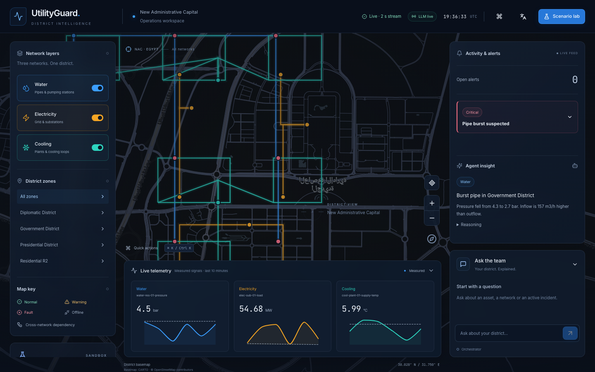
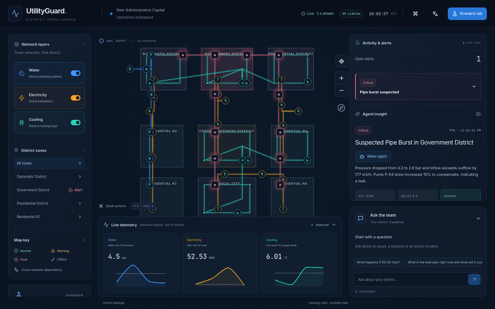

# Checkpoint: P0 + P1, backend through P5

## Done
- **Contract (P0):** Pydantic schemas for every shape, 26 generated fixtures plus the burst sequence, and the clarifications in contract 4.9 (the `chat_route` message was added).
- **Simulation:** seeded and deterministic, 9 zones, 49 assets, 91 sensors, 54 cross-network links. Normal ranges are calibrated from 14 days of normal operation, with daily weather variation. All 7 scenarios propagate across networks.
- **Detection:** leaks, trips, pump failure, cooling fault, overload and stuck sensors, plus an Isolation Forest. Alerts are grouped into one incident per root cause. Measured over 62 labelled runs: precision 1.0, recall 0.89 (the weakest faults are missed).
- **Cost engine:** the spec 9A formulas, a full calculation record, editable assumptions, and ±20% sensitivity.
- **Agents:** an LLM wrapper (Groq, retry, timeout, fallback cache), LangGraph specialists, an orchestrator that runs a what-if on a sandbox copy of the twin, and a number checker. Live on `openai/gpt-oss-120b` / `20b`.
- **ML:** LightGBM forecasts with a 10 to 90% band. MAPE: water 3.5%, electricity 1.7%, cooling 5.7%. Failure prediction AUC 0.85. A shadow twin supplies the expected values.
- **Extras:** PDF report, compare, sensor placement, drift.
- **Frontend (Codex):** shell, design system, map, layers, telemetry, alert list, agent insight, chat panel, mock server. Typecheck and build pass. It runs against the real backend.
- **Tests:** 59 backend tests and 9 frontend tests.

## Partly done or open (frontend)
- Zone polygons are not drawn on the map, and the network geometry is not fitted to the view.
- The "Open alerts" counter shows 0 while a critical alert is open (a store bug).
- No finding card with reasons, formula, assumptions and act now / delay / saving yet.
- Scenario lab, asset drawer, model performance view, compare and assumptions panels are not built yet.

## Decisions
D6 (models changed to gpt-oss) and D11. See decisions.md.

## Risks
- Codex runs without network access, so I install npm packages myself.
- The first backend start takes about 30 s (model training and evaluation). After that the models load from the cache.

## Next
Codex P2–P3 frontend: the finding card and explainability panels, the scenario lab, chat routing, the asset drawer and the zone polygons. Backend: record the fallback cache for the demo questions and write `scripts/demo_check.py`.

## Update: Codex frontend P2–P3 (merged)

- Done: open-alerts counter fixed, zone polygons drawn and the map fitted to the network, finding card, assumptions panel, scenario lab, chat with routing and suggested questions, asset drawer, status markers. Typecheck, lint, build and 15 tests pass.
- Seen in the live run: the finding card is cut off at the bottom of the right panel, so the act now / delay / saving values are hidden. It needs a scroll area or a collapsible alert block. Zone labels also overlap the markers.
- Still to check: scenario lab, chat and drawer clicks in a real browser, and the frame rate.
- Open contract questions from Codex: "Repair now" has no `equipment` input (the formula text should say `crew_callout + parts`; already true in the backend), and hourly results use the unit `EGP/h` (already true in the backend).
