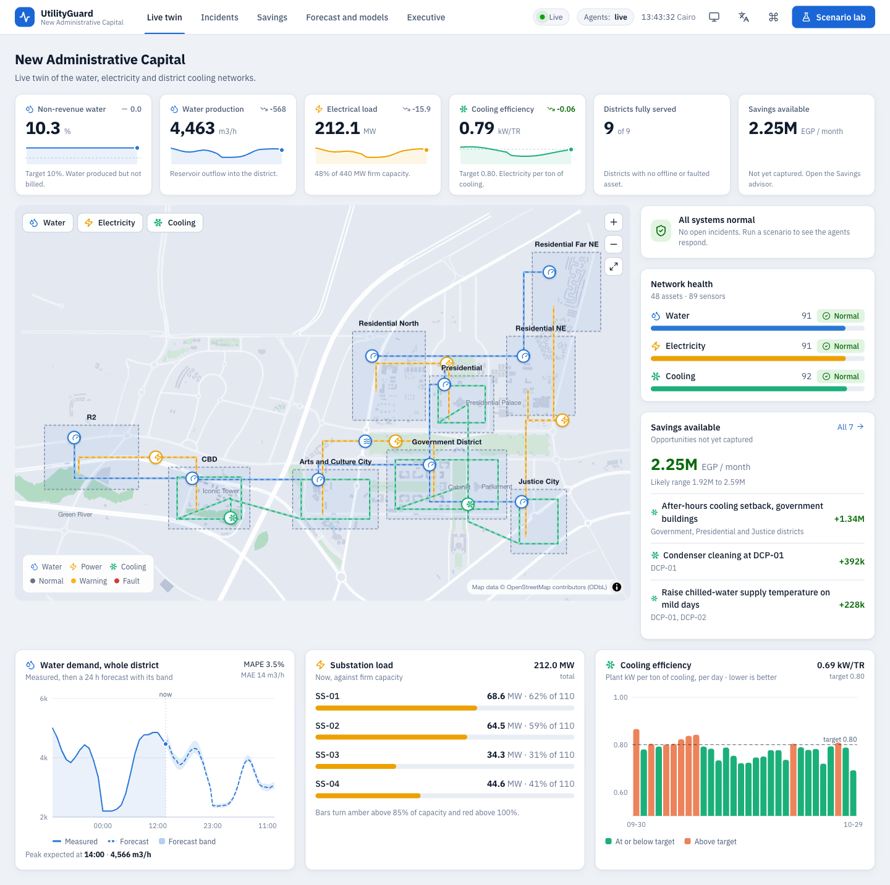
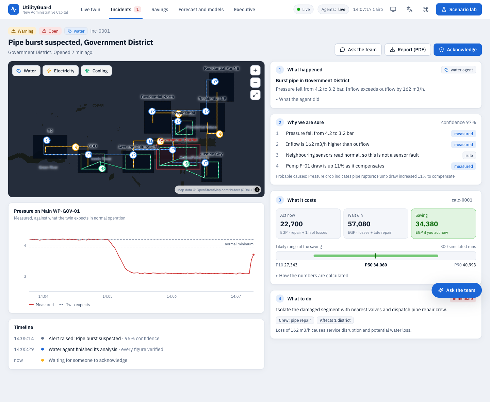
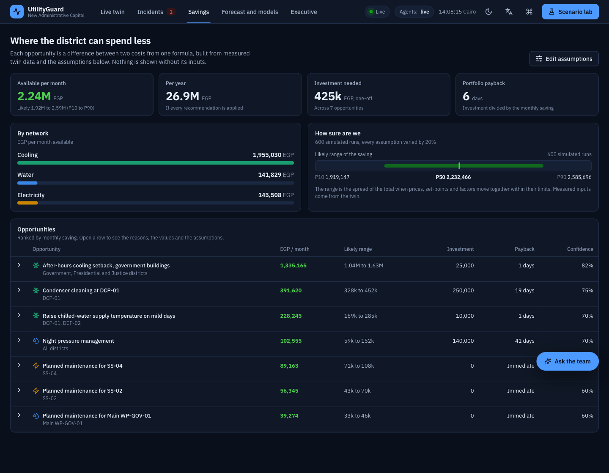
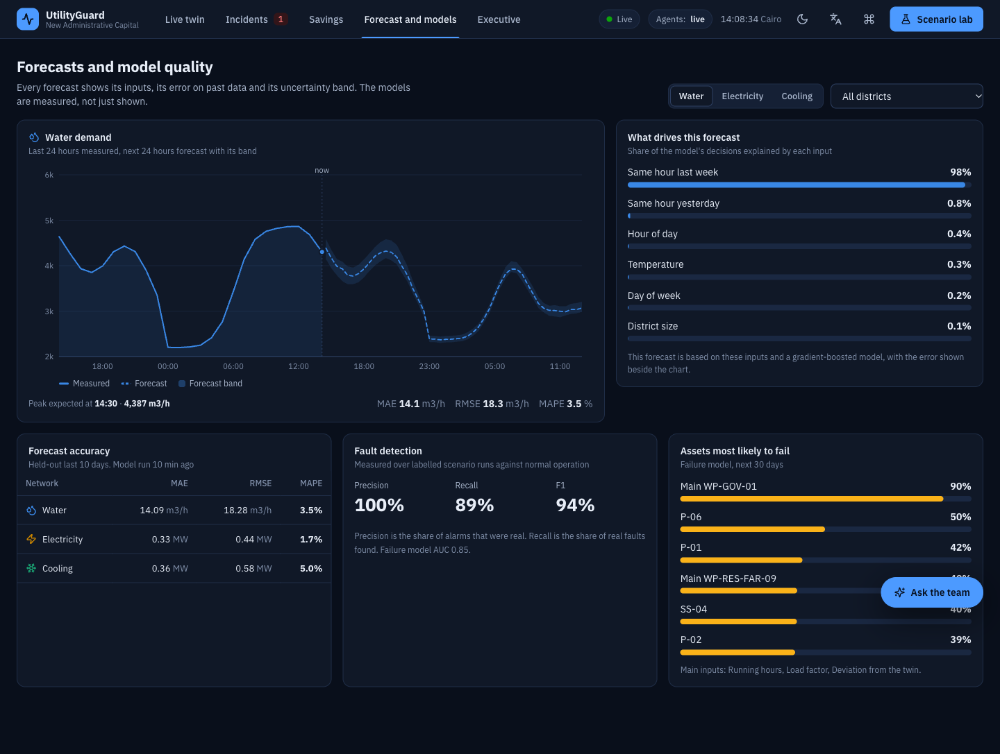

# Checkpoint: redesign, dashboards and the numbers behind them

## Done
- **Frontend rebuilt by Claude** from the approved mockup: five pages (Live twin, Incidents, Savings, Forecast and models, Executive), light and dark themes, IBM Plex Sans, hand-built SVG charts that follow the dataviz rules, a 2D city map drawn from real OpenStreetMap data (1,228 buildings, roads, parks, the Green River) that works offline, scenario lab, chat with live routing, asset drawer, assumptions drawer, calculation drawer, command palette, toasts, skeleton / empty / error states, Arabic RTL layout, mobile layout.
- **Numbers behind the dashboard (backend):** KPIs, demand and substation series, cooling efficiency by day, and the savings advisor with P10/P50/P90 from a Monte Carlo. Every opportunity shows its formula with the real values, its reasons and its assumptions.
- **Cost model fixes (CEO playbook section 4):** response time added (the saving no longer assumes the loss stops the instant the crew is sent), the breakdown now adds up to the cost of delay exactly, P10/P50/P90 on every incident saving, new editable assumptions.
- **Twin realism:** background water loss (so non-revenue water is a real number), chiller efficiency that depends on heat and fouling, pumps that hold their discharge pressure (a burst is now local instead of rippling through the whole network), incidents list every affected network.
- **New messages and endpoints (contract 4.9 and 4.10):** `incident` over the WebSocket, `/kpis`, `/series/*`, `/savings`, `/sensors/{id}/history`.
- **Bugs found by running the real UI and the demo script, now covered by tests:** chat endpoint could not start its task, KPIs failed right after a reset, new incidents never reached the UI, recorded answers with stale figures were scrubbed into holes.
- **Definition of done:** `scripts/demo_check.py` runs the whole demo path 3 times in a row without a restart (live and with the LLM offline). 73 backend tests, 21 frontend tests, build and lint pass.

## Not done yet
- Full Arabic translation (the layout is right-to-left and the navigation is translated; page copy is still English).
- Human approval of an agent's proposed action, agent debate, voice questions, Gas agent (see wow-ideas.md).
- More scenarios from the playbook (hidden leakage, low delta-T, power factor, Ramadan, big event, load shedding) and the remaining cost items (value of lost load, customers-based penalties, tornado chart).
- The forecast leans almost entirely on "same hour last week" because the simulator repeats weekly; adding week-to-week variation would make the model show more of its inputs.
- Frame rate was only checked in a headless browser without a GPU; check it on the presentation machine.

## Risks
- First backend start trains the models (about one minute). Start the server before the audience arrives.
- The Groq key was pasted in a chat session: rotate it.
